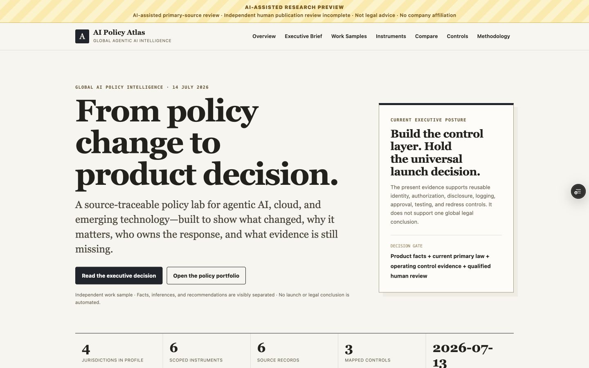

# AI Policy Atlas

**Global Agentic AI Policy Intelligence Lab** — an independent portfolio project that turns policy change into business implications, product controls, public-affairs work products, and explicit decision gates.

> **Readiness split:** the applied policy research portfolio is ready for public review; the structured production corpus remains publication-gated. AI-assisted preview research is not legal advice and has not completed independent human legal review.

[Open the live research Preview — preview-only](https://ai-policy-atlas-ax2183-5057-ao-xus-projects.vercel.app)



## Project quick read

The project demonstrates six parts of an applied global AI policy research workflow:

1. **Monitor:** a [July-August policy-change refresh](docs/deliverables/POLICY_REFRESH_2026-08-06.md), [dated global policy intelligence brief](docs/deliverables/GLOBAL_AI_POLICY_INTELLIGENCE_BRIEF_2026-08-06.md), and [agentic AI / semiconductor / compute / cloud radar](docs/deliverables/EMERGING_TECH_POLICY_RADAR.md).
2. **Synthesize:** an [executive briefing deck](docs/deliverables/Global_AI_Policy_Executive_Briefing.pptx), [decision brief](docs/deliverables/EXECUTIVE_DECISION_BRIEF.md), and [policy memo](docs/deliverables/POLICY_MEMO_HUMAN_OVERSIGHT_AND_DISCLOSURE.md).
3. **Translate:** a [business implications matrix](docs/deliverables/BUSINESS_IMPLICATIONS_MATRIX.md) and [Tencent public-information implications brief](docs/deliverables/TENCENT_PUBLIC_INFORMATION_IMPLICATIONS_BRIEF.md) connecting policy signals to business, product, cloud, security, and engineering questions.
4. **Operationalize:** an [applied AI risk-management method](https://ai-policy-atlas-ax2183-5057-ao-xus-projects.vercel.app/risk-management) that separates NIST foundation, Atlas proposal, and product decision question across GOVERN, MAP, MEASURE, and MANAGE.
5. **Engage:** a [policy-position sample](docs/deliverables/POLICY_POSITION_NOTE_SAMPLE.md), [consultation response](docs/deliverables/CONSULTATION_RESPONSE_SAMPLE.md), [speaking brief](docs/deliverables/SPEAKING_BRIEF_SAMPLE.md), [industry initiatives tracker](docs/deliverables/INDUSTRY_INITIATIVES_TRACKER.md), [stakeholder landscape](docs/deliverables/STAKEHOLDER_LANDSCAPE.json), and [fictional meeting brief](docs/deliverables/MEETING_BRIEF_SAMPLE.md).
6. **Calibrate:** source tiers, lifecycle status, confidence, fact → inference → recommendation chains, an [ADRS sensitivity note](docs/deliverables/ADRS_SENSITIVITY_NOTE.md), and [generated corpus analysis](docs/deliverables/POLICY_CORPUS_DESCRIPTIVE_ANALYSIS.md) with explicit denominators.

The repository keeps the evidence and honest limits explicit. The dated policy refresh, current validation results, and exact Preview deployment record provide the public review baseline.

The Preview interface supports **English, Simplified Chinese, Spanish, and Portuguese** from the global language selector. The choice persists across navigation and reloads. Interface translation is a reading aid: official titles, quotations, source IDs, legal numbers, dated evidence, and downloadable artifacts remain in their verified language.

## The operating decision

The portfolio does not claim that one configuration is lawful everywhere. Its current executive posture is narrower and more useful:

> Build reusable identity, authorization, logging, disclosure, approval, testing, and redress controls now. Hold any universal launch decision until product facts, current primary law, operating evidence, and qualified market-specific review are available.

This is the throughline from policy source to accountable action:

`policy change → scoped fact → analytical implication → product/control owner → evidence gate → decision`

## What is genuinely ready

| Layer | Status | Meaning |
|---|---|---|
| Policy work-sample portfolio | **Ready for public review** | Dated, source-linked writing across monitoring, strategy, position development, stakeholder preparation, and executive communication, including the 2026-08-06 change refresh |
| Curated research snapshot | **Runnable, non-production** | Six instruments, two provisions, four jurisdictions, and their validated dependencies; persistent AI-assisted-research boundary |
| Multilingual presentation layer | **Ready in Preview** | Persistent English, Simplified Chinese, Spanish, and Portuguese UI across the research routes; canonical evidence and English downloads remain unchanged |
| Applied AI risk-management method | **Ready in Preview** | Four-function NIST AI RMF application with public-fact/proposal boundaries, product-surface mapping, accountable roles, metrics, management options, and official sources |
| Fixture product demo | **Runnable, fictional** | Interaction, calculation, and design testing only; never deploy |
| Production application path | **Fail-closed** | Structured records render only when `review_status` is `published` and the latest independent owner approval matches the exact current record-and-source digest |
| Production corpus | **Not publication-ready** | No structured record is published; human Pass 2 review and owner decisions remain incomplete |

Working documents and preview downloads remain explicitly labeled in the repository. The production data boundary applies to structured application records; it does not turn working artifacts into approved publications.

## Applied research map

| Global AI policy competency | Evidence in this repository |
|---|---|
| AI, GenAI, agentic AI, semiconductors, and emerging-tech monitoring | 2026-08-06 change refresh, intelligence brief, compute/cloud radar, and NIST/IMDA/BIS/CADA/Korea/UK source register |
| US and international policy comparison | Structured US/EU/China/Singapore Atlas plus Korea/UK monitoring samples |
| Briefings, memoranda, presentations, and executive summaries | Executive page, Markdown briefs, policy memo, and editable PowerPoint deck |
| Business, cloud, and technology implications | Six-surface business matrix, public-information-only Tencent brief, applied AI RMF product mapping, and policy-to-engineering control mappings |
| Risks and opportunities | Paired risk/opportunity analysis with reversible actions and escalation owners |
| Cross-functional work | Policy, legal, compliance, product, engineering, security, research, and leadership ownership fields |
| Policy positions and external materials | Position note, consultation response, speaking brief, and industry-initiatives tracker with explicit non-submission limits |
| Meeting and stakeholder preparation | Fictional meeting brief plus structured tracker; every relationship is marked `not_contacted` |
| Quantitative and qualitative analysis | ADRS method and sensitivity note, bounded as an uncalibrated prioritization heuristic |

## Research product and evidence model

The Atlas classifies policy instruments by type, bindingness, lifecycle, and regulatory approach; maps relevant provisions to agentic capabilities and governance risks; and maps those to technical and organizational controls.

`ADRS = min(100, InherentRisk × (1 − MitigationCredit) × J)`

ADRS supports prioritization and discussion. It is **not** a legal determination, compliance certification, probability estimate, or empirically calibrated risk score. See the [methodology decisions](docs/METHODOLOGY_DECISIONS.md) and [sensitivity note](docs/deliverables/ADRS_SENSITIVITY_NOTE.md).

## Build profiles

| Mode | Content | Purpose | Deployment boundary |
|---|---|---|---|
| `fixtures` | Explicitly fictional scenarios and records | Demo, interaction tests, design review | Never deploy |
| `preview` | Curated structured research records plus clearly labeled applied work samples | Public research preview | Never Production; no completed human legal review |
| `production` | Published structured records only | Publication-gated delivery | Currently renders an empty corpus state |

Production selection excludes `fixture:true` data and renders only eligible `published` structured records. Unpublished records may remain in the working dataset, but they are excluded from production pages; the build fails closed when no published instrument exists. The reconciled working corpus contains 18 sources, 15 instruments, 9 provisions, 13 controls, 10 control mappings, and 3 changelog records; every reviewable record remains `in_review`. See [current status](docs/CURRENT_PROJECT_STATUS.md), [publication readiness](docs/research/PUBLICATION_READINESS_REPORT.md), and [corpus inventory](docs/research/CORPUS_INVENTORY.md).

## Preview boundaries

The curated structured snapshot contains only `eu-gdpr`, `eu-gdpr:art22`, `us-co-sb26-189`, `us-eo-14179`, `cn-ai-labeling-measures`, `cn-genai-interim-measures`, `cn-genai-interim-measures:art9`, and `sg-mgf-genai`, plus validated dependencies. It is AI-assisted, source-traceable work prepared for public research review, not legal publication.

The public research Preview is live at <https://ai-policy-atlas-ax2183-5057-ao-xus-projects.vercel.app>. Vercel deployment `dpl_DprKHMMgCsxV3CMNcVNyyrps2Wmw` was created on 2026-08-07 at 10:11 KST with target `preview` and reached `Ready`; its immutable URL is <https://ai-policy-atlas-27ajcbsyv-ao-xus-projects.vercel.app>. The stable alias was checked across eight core routes for HTTP 200, four-language persistence, the current 7 August policy posture, canonical source links, em-dash comparison cells, browser behavior, and `X-Robots-Tag: noindex`. The deployment came from the multilingual working tree based on `main` commit `5527b8d`; no new Git commit was created, so it must not be described as a committed release. It remains a Preview-only research artifact, not a Production publication.

## Local setup and validation

```bash
npm ci
BUILD_PROFILE=preview npm run dev
```

```bash
npm run lint
npm run typecheck
npm test
npm run test:integration
npm run validate:preview
npm run build:preview
```

| Command | What it verifies |
|---|---|
| `npm run lint` | Static linting |
| `npm run typecheck` | TypeScript correctness |
| `npm test` | ADRS, schema, and validation behavior |
| `npm run test:integration` | Dataset, profile, and integrity pipeline |
| `npm run validate:fixtures` | Fictional corpus integrity |
| `npm run validate:preview` | Curated snapshot manifest, exports, and dependency integrity |
| `npm run validate:production` | Publication gate; expected to fail while records remain `in_review` |
| `npm run build:fixtures` | Fixture static build |
| `npm run build:preview` | AI-assisted research preview build |
| `npm run build:production` | Eligible only after publication validation passes |

Browser suites remain available as `test:e2e`, `test:e2e:preview`, and `test:e2e:production`. They are not required to understand the portfolio and should be run in an approved browser-testing environment.

## Suggested product walkthrough

Use the [2026-08-06 policy refresh](docs/deliverables/POLICY_REFRESH_2026-08-06.md) together with the route flow below. The exact Preview deployment record is maintained above.

Optional demonstration: change the top-right selector to another language, open one route, and refresh once to show persistence; then return to the preferred presentation language. Do not imply that the English downloadable evidence or official source text has been translated.

1. Open `/` and state the boundary: public research portfolio, human-gated production corpus.
2. Open `/executive-brief` and the policy refresh; explain what changed on 2 August 2026 and why reusable controls are supportable while universal launch approval is not.
3. Open GDPR Article 22 and trace primary text → scoped inference → control recommendation → confidence and review date.
4. Compare EU, US, China, and Singapore without flattening instrument type, bindingness, lifecycle, or coverage.
5. Open `/risk-management` to show how GOVERN, MAP, MEASURE, and MANAGE connect policy expectations, product context, technical evidence, and accountable decisions; keep the disclosed-fact versus Atlas-proposal boundary visible.
6. Open `/work-samples` to show monitoring, emerging-tech, business, policy-position, stakeholder, and quantitative artifacts.
7. End with the five decision gates and the remaining human-review requirements.

## Route map

`/` · `/policy-refresh` · `/executive-brief` · `/work-samples` · `/instruments` · `/jurisdictions` · `/compare` · `/scenarios` · `/risk-management` · `/risk-score` · `/taxonomy/policy` · `/taxonomy/capabilities` · `/taxonomy/risks` · `/controls` · `/methodology` · `/bibliography` · `/glossary` · `/about` · `/downloads`

Legacy paths `/calculator`, `/policies`, and `/brief` permanently redirect to canonical routes.

## Repository structure

- `src/app/` — Next.js App Router pages and profile-aware presentation layer
- `src/components/` — semantic UI and interactive calculator/tracker
- `src/data/fixtures/` — explicitly fictional demo corpus
- `src/data/content/` — real working corpus, publication-gated
- `src/lib/` — ADRS, schemas, validation, applicability, and profile logic
- `docs/deliverables/` — policy work samples and executive deck
- `docs/research/` — review queue, evidence register, and publication artifacts
- `design/screenshots/` — reviewer-facing visual evidence

## Remaining gaps

1. Complete independent human policy/legal review and record a revision-bound owner decision (`record_sha256`) for every structured record; any substantive record or referenced-source edit requires a new decision.
2. Deepen provision-level coverage, especially outside the current four-jurisdiction structured preview.
3. Add real stakeholder engagement and cross-functional outcomes only when they actually occur; do not simulate experience as fact.
4. Re-run production validation and browser checks only after records are eligible for publication.
5. For every future Preview refresh, record the deployment ID, source state, live route checks, and `noindex` result before describing it as live.
6. Keep the hosted Preview separate from Production until independently reviewed records satisfy the publication gate.

## Disclaimer

AI Policy Atlas is an independent research and application portfolio project. It is not legal advice, does not certify compliance, and is not affiliated with or representative of Tencent or any other company, government, regulator, or standards body.
